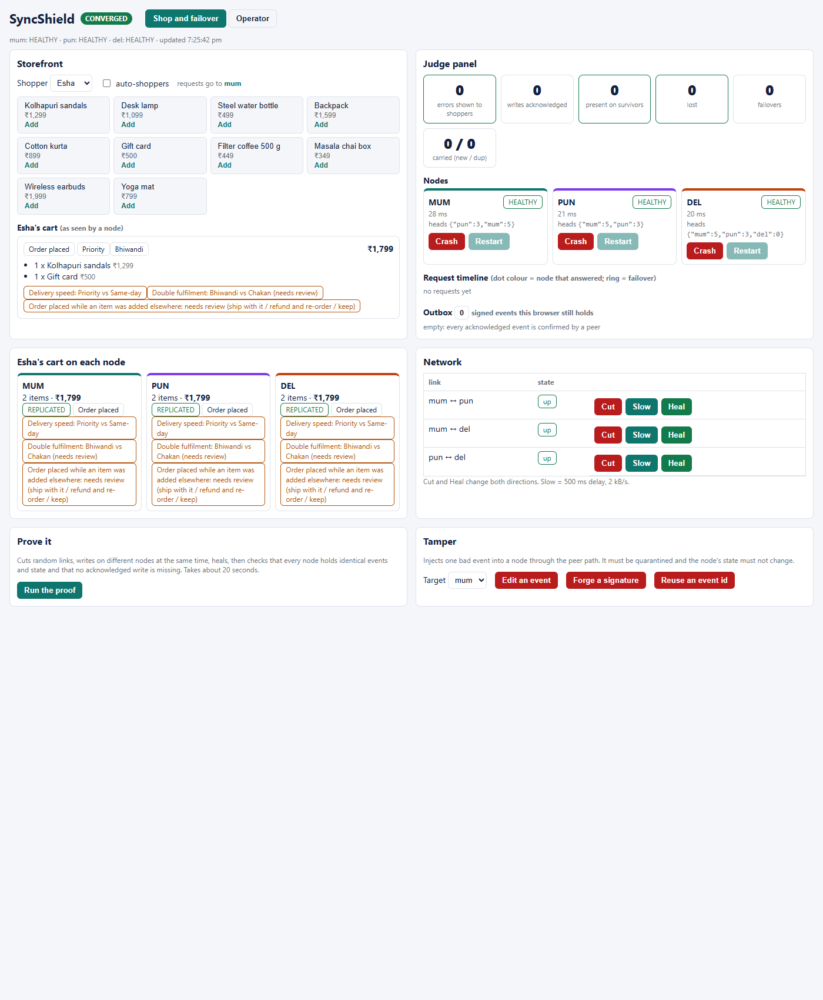
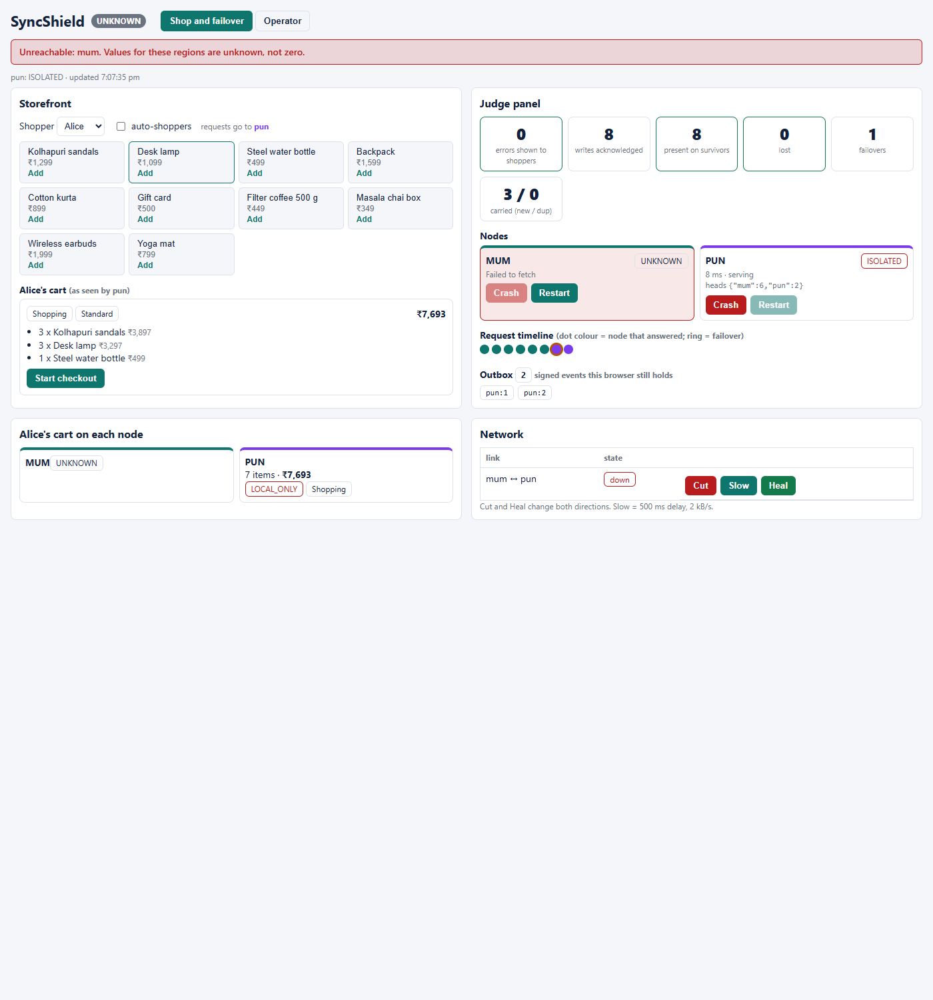
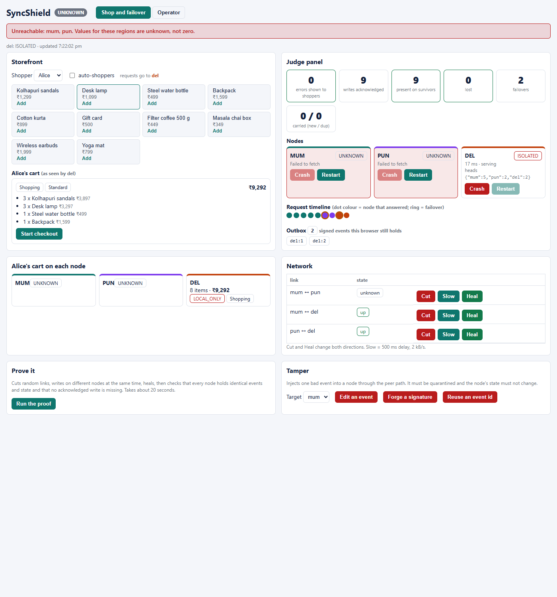
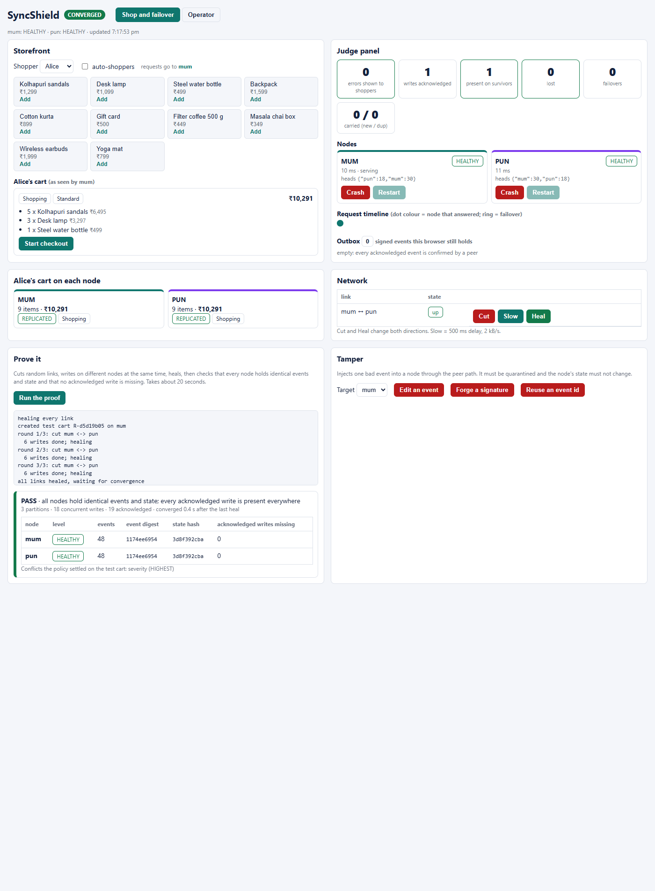
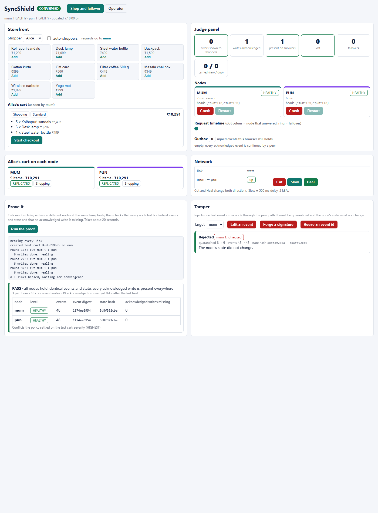
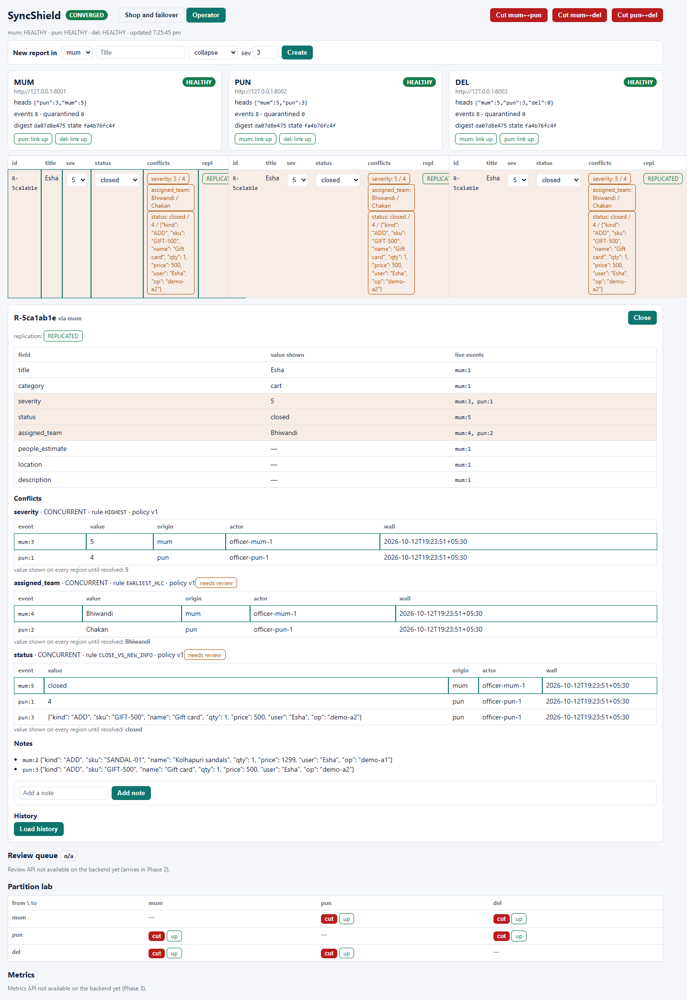

# SyncShield

**Zero-loss failover, safe conflict resolution, honest consistency.**
*"Regions can die. Shoppers won't notice. No add-to-cart is lost."*

CodeAstra 2.0 (RGIT) · Cloud Computing and Distributed Systems · PS2
Team: Akshit Sharma (A), Rahil (B), Miti Shah (C), Simrit (D)

> **How to edit this file.** Every section sits between `<!-- BEGIN:... -->` and `<!-- END:... -->`
> markers with an owner. Send your text as a PR touching only your own block; Miti resolves layout.
> Nothing here is described as implemented until its test passes (see *Status*).

<!-- BEGIN:problem owner=C -->
## Problem and approach

A data layer for apps that run in several regions. When a whole node dies or the network between
nodes breaks, the shopper's browser quietly moves to the next node, no acknowledged write is lost,
concurrent edits are settled by written safety rules (or a supervisor), and every screen says
honestly how far to trust what it shows.

"Disaster" here means any anomaly that interrupts the normal flow: a node crash, a network
partition, a slow link, a traffic spike, tampered data. The demo domain is an online shop
(carts, add-to-cart, checkout) running on a domain-neutral event engine.

| Claim we will measure | Evidence |
|---|---|
| 0 errors shown to shoppers while a node is killed | judge-panel counter, test T20 |
| 0 acknowledged add-to-carts lost | "acknowledged = present on survivors" counter, test T17 (kill -9) |
| No concurrent edit silently overwritten | conflict receipts, review queue, tests T4 T6 T7 |
| Status is never greener than the facts | UNKNOWN badge, CONVERGED only with equal digests, tests T1 T2 F1 |
<!-- END:problem -->

<!-- BEGIN:consistency owner=C -->
## Consistency model and defence

**AP with strong eventual consistency.** Any node accepts valid writes during a partition; two
nodes holding the same set of events derive identical state. Reads are local and may be stale; the
API says when. No consensus (Raft/Paxos): a cut-off node would have to refuse orders, and refusing
is the worse failure.

1. Every change is an **immutable event** (`CREATE`, `SET`, `NOTE`, `RESOLVE`) with a per-origin
   gap-free `seq`, a hybrid logical clock (tie-break only) and a content hash.
2. **`supersedes` pointers carry causality.** A write lists the field values it saw and replaces.
   Two writes to one field where neither replaced the other are *concurrent*, which is a conflict.
3. **`derive()` is a pure function of the event set.** Order, duplicates and relays do not matter.
4. **Replication = copying missing events**: pull by per-origin watermark (authoritative), push as
   a shortcut, and browser-carried signed events on failover. All three go through one idempotent `ingest()`.

Full write-up: [docs/consistency-model.md](docs/consistency-model.md).
<!-- END:consistency -->

<!-- BEGIN:architecture owner=C -->
## Architecture


Each node is a full stack with its own SQLite file. The browser SDK talks to the preferred node and
fails over to the others; nodes replicate to each other; the chaos agent can kill any node.
Details: [docs/architecture.md](docs/architecture.md), shop mapping: [docs/shop-mapping.md](docs/shop-mapping.md).
<!-- END:architecture -->

<!-- BEGIN:policy owner=B -->
## Conflict policy (v1)

Applied only when the live values of a field disagree. Writes that saw the old value are updates, never conflicts.

| field | concurrent rule | review |
|---|---|---|
| title, description, category | latest by HLC order | no |
| severity (delivery speed) | highest | receipt only |
| status | most active wins (open < assigned < resolved < closed = cancelled), latest breaks ties | yes |
| assigned_team (fulfilment centre) | earliest by HLC order, flag `DOUBLE_DISPATCH` | yes |
| location | latest; review if candidates are 200 m or more apart | if far |
| people_estimate | highest, never summed | yes |
| notes (cart activity) | union by event id; one `op_id` is one write | n/a |
| close vs new information | status stays as derived; `CLOSE_VS_NEW_INFO` review item | yes |
| two supervisor decisions that differ | the field's rule again, flag `RESOLVE_VS_RESOLVE` | yes |

One line of reasoning per rule, the receipt shape and the accepted-event rule (shape, known origin,
unchanged hash, the origin's Ed25519 signature) are in [docs/conflict-policy.md](docs/conflict-policy.md).
Full contract: [contracts/contracts.md](contracts/contracts.md#6-v11-additions-implemented-additive).
<!-- END:policy -->

<!-- BEGIN:demo owner=C -->
## What it looks like (real nodes, nothing mocked)

| | |
|---|---|
|  | **Shop and failover console.** Three nodes hold the same cart. A close raced with a new item and a team assignment; the policy kept severity 5 and Bhiwandi and flagged both for review. |
|  | **Zero-loss failover.** The link was cut, three writes existed only on Mumbai, Mumbai was killed. The browser carried those 3 events to Pune: 0 errors, 0 lost. |
|  | **Cascade.** Delhi joined empty and converged; then Mumbai and Pune were crashed in turn and Delhi kept serving. |
|  | **Prove it.** Random cuts and concurrent writes, then identical digests and state on every node, and no acknowledged write missing. |
|  | **Tamper.** An edited, forged and id-reusing event are each quarantined and the node's state hash does not change. |
|  | **Operator view.** Per-node reports, conflict receipts with rule and candidates, and the history drawer. |

Three-minute walkthrough (Appendix A of the plan): add items (auto-shoppers) -> hold **Crash** on a node -> **Restart** ->
**Cut**, edit on both sides, **Heal** (conflict chips) -> **Run the proof**.
<!-- END:demo -->

<!-- BEGIN:setup owner=C -->
## Stack and one-command setup

Python 3.11+, FastAPI, SQLite (WAL, one file per node), httpx, React + Vite. Needs Node 18+.

```bash
python -m venv .venv
.venv\Scripts\activate            # Windows   (Linux/macOS: source .venv/bin/activate)
pip install -r requirements.txt

python scripts/run_regions.py     # mum :8001, pun :8002, data in data/*.db; signing keys are created in keys/
python scripts/chaos_agent.py     # :9000, lets the UI crash/start nodes (dev only)
# three nodes: set REGIONS=mum,pun,del for run_one.py / chaos_agent.py and VITE_REGIONS in dashboard/.env

cd dashboard
copy .env.example .env            # (cp on Linux/macOS)
npm install
npm run dev                       # http://localhost:5173
```

UI without a backend: set `VITE_FIXTURES=1` in `dashboard/.env` (read-only, uses fixtures and mock data).

| node | port | database |
|---|---|---|
| mum | 8001 | `data/mum.db` |
| pun | 8002 | `data/pun.db` |
| del | 8003 | `data/del.db` (joins in Phase 3) |
| chaos agent | 9000 | `run/<region>.pid` |
| dashboard | 5173 | n/a |

All settings come from environment variables (see `.env.example`). Run **exactly one** Uvicorn worker
per node: sequence numbers are guarded by an in-process lock.
<!-- END:setup -->

<!-- BEGIN:api owner=A -->
## API

Header `X-API-Key: dev-officer`. Full contract: [contracts/contracts.md](contracts/contracts.md).

| method + path | purpose |
|---|---|
| `POST /v1/reports` | create a cart/report, `201` only after commit |
| `PATCH /v1/reports/{id}` | set a field; `expected` ids give `409` if stale |
| `POST /v1/reports/{id}/notes` | add a note (cart item) |
| `GET /v1/reports[/{id}]` | view with `state`, `live`, `conflicts`, `consistency` |
| `GET /v1/reports/{id}/history` | events of the report in order |
| `GET /v1/status` | level, heads, peers, digests, carry counters |
| `GET /healthz` | liveness + level, no key |
| `POST /v1/events/has` | `{ids}` -> `{missing}` |
| `POST /v1/carry` | a browser hands over signed events from a dead node (hash + signature verified) |
| `GET /internal/v1/sync/{summary,events}` · `POST .../push` | peer replication (503 when link down) |
| `POST /admin/links/{peer}` | `{mode: up\|down\|slow, delay_ms, rate_bps}` partition lab |

Writes accept an optional `op_id` (or `Idempotency-Key` header): the same operation is applied once, and a replay returns 200 with `Idempotent-Replay: true`. 2xx bodies carry the full signed `event`.

*(Akshit: add curl samples, and resolve and review when they land.)*
<!-- END:api -->

<!-- BEGIN:tests owner=B+D -->
## Tests and how to run them

```bash
pytest tests/engine        # pure engine: hash, HLC, derive and policy v1, signing, carry admission, priority
pytest tests/failover      # T17 zero-loss failover (in memory, and kill -9 on real processes) + T18 carry integrity
pytest tests/fuzz          # F1: three nodes, random writes, retries, partitions, tampering
pytest tests/shop          # shop fixtures (carts, split-brain, close-vs-new-info, op_id retry)
pytest tests/integration   # real node processes: replicate, restart, partition, heal, relay
pytest                     # everything
bash scripts/check_m1.sh   # curl evidence script (needs jq, nodes running)
python scripts/prove_it.py --chaos 3 --wait 20   # live: cut / write on both sides / heal, ends CONVERGED (exit 0)
```

Lane B results on the merged `main` (Windows laptop, Python 3.14; numbers from the runs, not estimates):

- **T17 zero-loss failover on real processes** (`tests/failover/test_t17_live.py`): Mumbai is killed with
  `kill -9` while holding 3 adds no peer has; the browser carries them to Pune; every acknowledged event is
  present on the survivor (`/v1/events/has` missing = []); 0 errors; Mumbai restarts and both converge with
  no duplicate items. Kill to first success on Pune: 52 to 61 ms over 4 runs. (T20 asks for p95 over 10
  runs; not measured yet.)
- **T18 carry integrity, T16 engine half, T1, T2, T4, T5, T6** and one test per policy rule: pass.
- **F1 fuzz:** 211 examples on 3 nodes, 5 480 writes, 1 839 retries under the same `op_id`, 361 tampered
  deliveries rejected, no divergence (`tests/fuzz/last_result.json`).

*(Simrit: add the T19-T22 results and scenario scripts.)*
<!-- END:tests -->

<!-- BEGIN:convergence owner=A+D -->
## Convergence integration (partner team)

*(Akshit and Simrit: partner PS, contract, negative tests. Until a real partner exists, say
"integration ready, partner service unavailable". Never present a mock as a real integration.)*
<!-- END:convergence -->

<!-- BEGIN:tr owner=D -->
## Trial and Reward log

*(Simrit: before/after numbers from `docs/tr-log.md`.)*
<!-- END:tr -->

<!-- BEGIN:status owner=C -->
## Status (honest)

| area | state |
|---|---|
| Independent nodes, local-first writes, pull + push replication, watermarks, partition and slow link, restart safety, roles, history, status digests | built, covered by the test suite |
| Chaos agent (crash / start a node, inject a tampered event) | built, verified live |
| Shop fixtures (carts, split-brain, close-vs-new-info, op_id retry) | built |
| op_id idempotency, Ed25519-signed events, `/v1/carry`, `/v1/events/has`, `/healthz` | built, covered by tests and verified live (kill -9 after a cut link lost nothing) |
| Policy v1 (highest speed, earliest centre + DOUBLE_DISPATCH, status ladder), CLOSE_VS_NEW_INFO | built, covered by tests (`tests/engine/test_policy_v1.py`, `tests/shop`) |
| Review queue and supervisor resolve (`/v1/review`, `/resolve`) | not built yet |
| Failover SDK + shop failover console (hold-to-crash, judge counters, timeline, outbox, network panel) | built; verified live against real nodes, including a hard crash after the link was cut (the browser carried 3 unreplicated events, 0 lost). Details: `docs/lane-c-progress.md` |
| Prove-it (random cuts + concurrent writes + heal, then digests and completeness checked), Tamper (edit / forge / reuse, quarantined, state unchanged) | built, verified live against real nodes |
| Failover latency (T20): crashed node p95 39 ms, hung node p95 631 ms | measured, see `docs/failover-latency.md` |
| Delhi as a third node: joins empty and converges; cascade crash of two nodes loses nothing | verified live |
| Randomized convergence test (F1, Hypothesis), metrics API, Burst, priority-queue evidence | not built yet |
<!-- END:status -->

<!-- BEGIN:limits owner=C -->
## Limits we state openly

- A write is lost only if its node dies before any peer has it **and** no browser outbox holds it
  (for example the tab was closed). Pushing critical events first shrinks that window; it cannot remove it.
- A node holding a valid signing key can still lie. No Byzantine tolerance is claimed.
- Localhost traffic is not TLS; a deployed VM needs a TLS reverse proxy.
- Revocations issued during a partition are unknown to the cut-off node until it reconnects.
- We do not claim 100% uptime. We claim: no error shown while any node answers, and no
  acknowledged write lost while any browser or peer holds it.
<!-- END:limits -->

<!-- BEGIN:credits owner=C -->
## Credits, AI use and team

Libraries: FastAPI, Uvicorn, httpx, Pydantic, SQLite, React, Vite, Hypothesis, pytest.
AI assistants were used as the event rules allow; each module's owner explains it line by line and
every PR was explained back by a teammate. Ideas (not code) came from the references in the build plan
(CouchDB conflict model, Jepsen, Bayou session guarantees, bounded counters); nothing was copied.

| lane | person | owns |
|---|---|---|
| A | Akshit Sharma | API, storage, security, contracts |
| B | Rahil | merge engine, signing, correctness tests |
| C | Miti Shah | frontend, chaos agent, fixtures, documentation |
| D | Simrit | replication, carry, runtime, Trial and Reward |
<!-- END:credits -->
