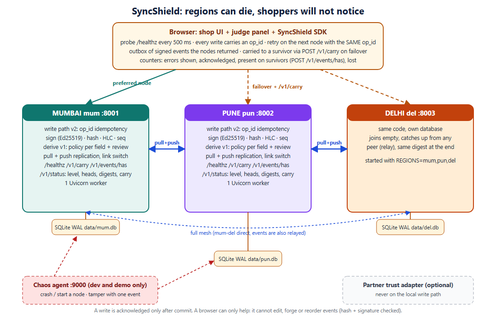

# Architecture

Source: `architecture.svg` (edit it, then re-export the PNG).

## The pieces

| piece | what it does | rule it obeys |
|---|---|---|
| Browser SDK (`dashboard/src/sdk`) | probes `/healthz`, sends each write with an `op_id`, retries on the next node with the same `op_id`, keeps an outbox of signed events, carries them on failover | never shows an error while any node answers |
| Node (`region/`) | its own SQLite file; write path, derive, replication, link switch, status | a write never waits for a peer; 201 only after commit |
| Signing (`region/engine/signing.py`) | Ed25519 over the event hash, by the origin node | a node never signs another node's events |
| Event log | append-only table, primary key `event_id`, `op_id` column | never updated, never deleted |
| `derive()` v1 | pure function from an event set to state and conflict receipts | no I/O, no randomness, no wall clock in decisions |
| Replication | pull by per-origin watermark (authoritative), push as a shortcut, browser carry as a third source | all three use the same idempotent `ingest()` |
| Link switch | up / down / slow per pair, enforced in both directions | demo and chaos only |
| Chaos agent (`scripts/chaos_agent.py`) | crash or start a node, inject one tampered event | admin key only, never on a public deployment |
| Partner adapter | credential check, optional anchoring | never on the local write path |

## Write path

validate, `op_id` replay check, allocate `seq`, HLC stamp, `observed` (close / new-info writes), hash, sign,
append, `derive()`, refresh the view, commit, then answer `201` with the report and the signed event.

## Failover and carry

1. The shopper's action goes to the preferred node with an `op_id`; the signed event comes back and is kept in the outbox.
2. The node serves the event to peers by pull and push. When any peer's head for that origin reaches the event's `seq`, the SDK drops it from the outbox.
3. The node dies. Events no peer had yet exist only on its disk and in the browser outbox.
4. The next request fails; the SDK retries on the next node with the same `op_id`, after posting its outbox to `POST /v1/carry`.
5. The survivor checks hash and signature, ingests through the normal path, and answers. A retry that already arrived by replication or carry returns the existing event, so nothing is written twice.
6. The dead node restarts, replays its log and pulls from peers; duplicates are ignored by event id.

Measured: a crashed node costs the shopper about 35 ms, a hung node about one request timeout (620 ms). See [failover-latency.md](failover-latency.md).

## Where code lives

| concern | path |
|---|---|
| shapes, validation, contract | `contracts/` |
| API and write path | `region/api/` |
| storage and migrations | `region/store.py`, `region/migrations/` |
| merge engine (pure) | `region/engine/` (`derive.py`, `signing.py`, `canonical.py`, `hlc.py`, `digest.py`) |
| replication, carry, link switch | `region/sync/` |
| browser SDK, shop adapter, UI | `dashboard/src/` |
| chaos, fixtures, run scripts | `scripts/`, `fixtures/` |

The dashboard shows only what the backend reports; an unreachable node is shown as unknown, never as empty.
